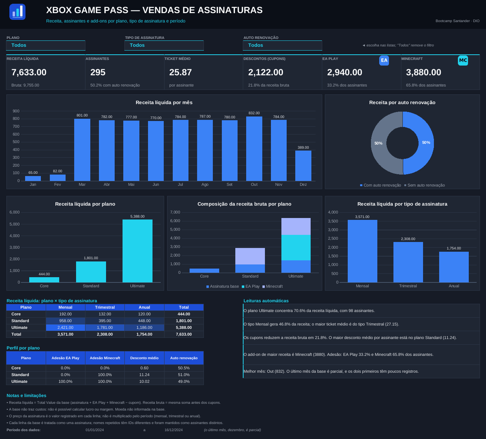

# Dashboard de Vendas no Excel — Xbox Game Pass

Autor: [Marcelo Siqueira](https://github.com/marcxellcamargo-cloud)

Projeto prático do bootcamp **Santander — Excel com IA e Claude**, da plataforma **DIO**.



> A imagem acima foi gerada a partir do arquivo com o LibreOffice; no Microsoft Excel a aparência pode variar levemente.

## Contexto e objetivo

O desafio propõe transformar uma base de dados em um dashboard de vendas claro e útil para a tomada de decisão. A base fornecida pela DIO traz **assinaturas do Xbox Game Pass**, e o objetivo é responder perguntas de negócio sobre faturamento, planos, tipos de assinatura e vendas de add-ons (EA Play e Minecraft Season Pass).

A inteligência artificial (Claude) foi usada como apoio na análise da base, no planejamento dos indicadores, na construção das fórmulas e dos gráficos e na validação dos resultados.

## Ferramentas utilizadas

- Microsoft Excel (arquivo `.xlsx`)
- Fórmulas `SUMIFS`, `COUNTIFS`, `EDATE`, `IFERROR` e nomes definidos
- Gráficos nativos do Excel
- Validação de dados (listas suspensas) para os filtros
- Python (Pillow), apenas para criar os ícones do projeto
- Claude (Anthropic) como assistente de IA

## Descrição dos dados

A aba `B̳ases` contém uma Tabela do Excel (`Tabela1`) com **295 registros** (1 linha = 1 assinatura), de **01/01/2024 a 16/12/2024**, sem valores nulos.

| Campo | Descrição |
|---|---|
| Subscriber ID, Name | Identificação do assinante (15 nomes se repetem, mas com IDs diferentes) |
| Plan | Plano: Core, Standard ou Ultimate |
| Start Date | Data de início |
| Auto Renewal | Renovação automática (Yes/No) |
| Subscription Type | Monthly, Quarterly ou Annual |
| Subscription Price | Preço da assinatura |
| EA Play Season Pass (+ Price) | Adesão e preço do add-on EA Play |
| Minecraft Season Pass (+ Price) | Adesão e preço do add-on Minecraft |
| Coupon Value | Valor do cupom de desconto |
| Total Value | Assinatura + EA Play + Minecraft − cupom |

A base original **não foi alterada**. Foi conferido que `Total Value` fecha com os componentes em todas as 295 linhas.

### Limitações da base

- Não há custos, então **não é possível calcular lucro ou margem**.
- A moeda não é informada.
- O preço da assinatura é o valor registrado em cada linha: não é multiplicado pelo período (mensal, trimestral ou anual), portanto não é possível calcular receita recorrente (MRR).
- Não há campos de região, produto ou número de pedido.
- Dezembro/2024 é parcial (último registro em 16/12) e janeiro e fevereiro têm poucos registros.

## Indicadores apresentados

| Indicador | Definição |
|---|---|
| Receita líquida (faturamento) | Soma de `Total Value` |
| Receita bruta | Assinatura + EA Play + Minecraft, antes dos cupons |
| Assinantes | Número de registros |
| Ticket médio | Receita líquida ÷ assinantes |
| Descontos (cupons) | Soma de `Coupon Value` e % sobre a receita bruta |
| Receita EA Play / Minecraft | Soma do preço de cada add-on e % de adesão |
| % com auto renovação | Assinantes com `Auto Renewal = Yes` |

Gráficos: receita líquida por mês, receita por auto renovação, receita por plano, composição da receita bruta por plano (assinatura base, EA Play e Minecraft) e receita por tipo de assinatura.

Análises adicionais (além das perguntas do desafio):

- **Matriz plano × tipo de assinatura:** receita líquida em tabela com escala de cores (formatação condicional).
- **Perfil por plano:** adesão ao EA Play e ao Minecraft, desconto médio por assinante e % com auto renovação.
- **Perfil por tipo de assinatura** (aba `C̳álculos`): desconto médio por assinante e % com auto renovação.
- **Leituras automáticas:** 5 frases geradas por fórmula (plano e tipo líderes, descontos, add-ons e melhor mês) que mudam conforme os filtros.

Resultados com a base completa: receita líquida de 7.633,00; 295 assinantes; ticket médio de 25,87; descontos de 2.122,00 (21,8% da receita bruta de 9.755,00).

## Principais recursos implementados

- Dashboard com KPIs no topo, 5 gráficos nativos do Excel, matriz com escala de cores, perfil por plano e leituras automáticas.
- **Filtros por lista suspensa** (Plano, Tipo de assinatura e Auto renovação) que atualizam KPIs, gráficos, matriz e leituras. Na matriz, os filtros de plano e tipo zeram as combinações não selecionadas.
- Aba de cálculos separada, com todas as fórmulas documentadas e respostas às 4 perguntas de negócio do desafio:
  1. Faturamento total de planos anuais.
  2. Faturamento de planos anuais separado por auto renovação.
  3. Total de vendas do EA Play (por plano).
  4. Total de vendas do Minecraft Season Pass (por plano).
- Bloco de **conferências automáticas** (as somas por mês, plano, tipo e auto renovação precisam fechar com o total).
- As fórmulas leem até a linha 2000 da base, então novos registros adicionados à tabela entram nos cálculos.

### O que NÃO foi implementado

- **Tabelas Dinâmicas e Segmentações de Dados (slicers)**: os filtros foram feitos com listas suspensas e fórmulas. Os cálculos do projeto foram validados por recálculo no LibreOffice e comparados com um cálculo independente em Python; o arquivo não foi testado manualmente no Excel.

## Identidade visual

A identidade visual foi **personalizada** em relação ao modelo de apoio da DIO: o dashboard usa um tema escuro (grafite) com destaques em azul e ciano, e os logos e ícones originais do modelo não foram utilizados.

| Cor | Uso |
|---|---|
| `#0B0F17` / `#161B26` / `#1F2633` | Cabeçalho, fundo da página e cartões (grafite) |
| `#3B82F6` | Azul, destaque principal |
| `#22D3EE` | Ciano, destaque secundário e bordas |
| `#A5B4FC` | Índigo claro, terceira série do gráfico empilhado |
| `#64748B` | Ardósia, categoria neutra |
| `#1D4ED8` | Azul escuro, cabeçalhos de tabelas |

Os ícones (painel de barras no cabeçalho e os selos "EA" e "MC" dos cartões de add-ons) foram criados para este projeto. A paleta e os ícones estão documentados na aba `A̳ssets`.

## Como abrir e utilizar

1. Abra `dashboard_vendas_xbox_game_pass.xlsx` no Microsoft Excel. Se aparecer o Modo de Exibição Protegido, clique em **Habilitar Edição**.
2. A aba `D̳ashboard` abre por padrão. Use as três listas no topo para filtrar (escolha **Todos** para limpar).
3. Para ver como cada número é calculado, abra a aba `C̳álculos`.
4. Para atualizar os dados, adicione linhas à `Tabela1` na aba `B̳ases`.

Abas: `A̳ssets` (paleta de cores e ícones do projeto), `B̳ases` (dados), `C̳álculos` (cálculos de apoio) e `D̳ashboard` (painel).

## Estrutura do repositório

```
├── dashboard_vendas_xbox_game_pass.xlsx   # planilha final
├── dashboard_preview.png                  # prévia do dashboard
└── README.md
```

## Créditos

Projeto desenvolvido como desafio do bootcamp **Santander — Excel com IA e Claude**, da **[DIO](https://www.dio.me/)**. A base de dados e a estrutura de abas do modelo de planilha foram fornecidas pela DIO. A paleta de cores e os ícones são originais deste projeto.
